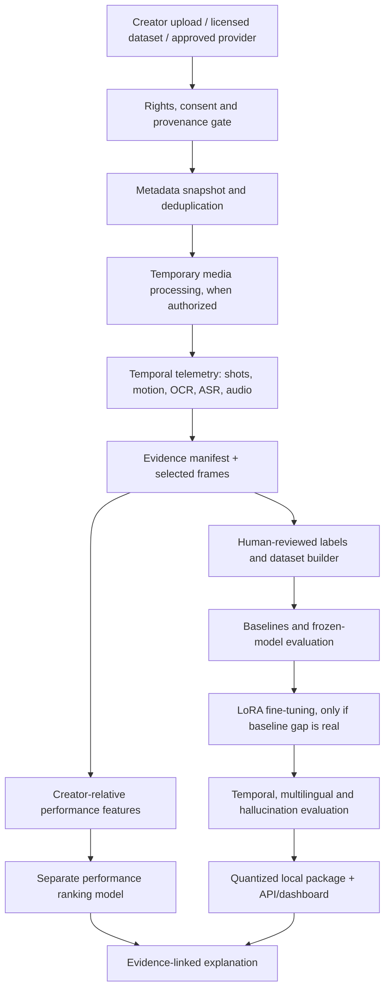

# Shorts Language Model — Global Master Plan

> **Direction (20 November 2026):** build a rights-aware, multilingual short-form video intelligence system using deterministic temporal telemetry, a compact multimodal reasoning model, and a separate creator-normalized performance predictor.
>
> **Not the plan:** mass-scrape or download 100–200 million third-party Reels/Shorts, train a foundation model from scratch, or claim that view counts alone prove why a video went viral.

<p align="center">
  
</p>

## 1. Product vision

Given a short-form video the user or project is authorized to process, plus permitted metadata, the system should produce:

- a grounded description of what is visible, spoken and written;
- a timestamped account of scenes, cuts, transitions, effects, framing, movement, pacing, captions and audio;
- language, topic, title, description and hashtag analysis;
- plausible attention/retention hypotheses linked to evidence;
- comparable examples from a rights-cleared corpus;
- actionable suggestions for improving a new short.

It must support speech-heavy clips, music-only edits, silent visual sequences and multiple languages. It must distinguish correlation from causation.

## 2. Final architecture decision

Use a **hybrid, tool-grounded multimodal system**, not one giant video LLM.

1. **Acquisition and provenance:** creator uploads, creator-authorized media, licensed datasets and approved research access. Metadata-only access stays metadata-only unless an applicable agreement explicitly permits more.
2. **Deterministic telemetry:** media validation, scene/shot boundaries, keyframes, OCR, multilingual ASR, audio events, motion and editing candidates. Every event includes timestamp, tool version, evidence and confidence.
3. **Evidence store:** compact JSON/Parquet records and selected keyframes. Raw media is temporary by default and retained only where rights and policy allow.
4. **Learning layer:** first establish non-LLM and frozen-model baselines. Fine-tune an open multimodal model only after identifying measurable weaknesses and reviewing labels.
5. **Performance research:** a separate LightGBM/ranking model studies creator-relative performance from authorized outcomes. The VLM explains evidence; it does not invent the score.
6. **Local deployment:** quantized compact model with CPU-capable preprocessing. GPU fit and speed must be measured on actual target hardware.



## 3. Research question

Can compact multimodal models, grounded by measurable audiovisual telemetry and carefully designed comparison data, identify short-form storytelling and editing patterns more accurately and usefully than frozen models and simple baselines?

Secondary questions: which edit types can be detected at sub-second timescales; do audio/OCR/speech/motion signals add predictive value; does creator normalization reduce mega-channel bias; does fine-tuning beat prompting; which components run acceptably on 4 GB GPUs or CPU-only laptops?

## 4. Dataset scale and sampling

The original 5–10 crore per platform ambition is recorded as a **long-term discovery ambition only**, not a committed corpus size or legal acquisition plan. No global supply ceiling is inferred from the supplied sample chart.

| Gate | Unique videos | Purpose |
|---|---:|---|
| Smoke fixture | 25–50 | Pipeline correctness |
| Diagnostic pilot | 300 | Tool quality, annotation effort and cost/video |
| First research set | 1K–2K | Coverage and baseline evaluation |
| First SFT candidate | 5K–10K | Measure whether reviewed labels improve a model |
| Expansion | 20K–50K | Broader creator/category generalization |
| Large research | 100K–500K+ | Only after rights and unit economics pass |
| Millions / crore-scale | Conditional | Requires rights, budget and demonstrated marginal value |

Do not sample only videos above one million views. Include ordinary-performing controls, creator baselines, varied creator sizes, language/script, category, duration, publication period, speech/no-speech and edit styles. Use same-creator matched controls when permitted. Treat any 70/30 mix as an experiment, not a universal ratio.

A creator-relative outcome can be explored, for example:

`relative = log1p(video outcome) - median(log1p(eligible creator outcomes in baseline window))`

Define the baseline window, eligible uploads and minimum count before use. Compare only compatible platform metrics and observation windows. Store raw snapshots and normalized targets separately.

**Splits:** creator/account-disjoint, time-forward holdout, cross-post deduplication before splitting, and a locked golden test set.

## 5. Model choice

Benchmark candidates on identical authorized clips and inputs:

- Qwen3-VL-2B — initial compact VLM baseline;
- Qwen3.5-2B / 4B — candidates after verifying exact card, runtime, training and deployment support;
- VideoLLaMA3-2B — video-centric comparison;
- SmolVLM2-500M — low-resource smoke baseline;
- a larger open-weight teacher — optional, only with compatible terms and audited labels.

Select by measured short-video performance, temporal grounding, multilingual coverage, license, framework support and local inference—not model name or vendor score alone.

Use a pretrained decoder-based multimodal VLM. Specialist audio tools initially supply timestamped transcript and acoustic features. Fine-tuning order: frozen prompt baseline → reviewed SFT with LoRA/DoRA → optional preference/RL only after stable SFT and verifiable reward checks. QLoRA and exact YAML settings are model-specific, not assumed universal.

## 6. Temporal telemetry

Do not rely only on 1 FPS. Combine a dense hook window (0–3 seconds), frames around candidate cuts, shot midpoints, motion peaks, climax/end frames and possible loop seam. A 12–16 frame VLM budget is an experiment, not guaranteed coverage.

| Signal | Initial candidates | Output |
|---|---|---|
| Shots | TransNetV2 / PySceneDetect | boundaries, type candidates, confidence |
| Motion | OpenCV optical flow | movement statistics; add RAFT/GMFlow only if needed |
| Zoom/shake/speed | motion and frame geometry heuristics | candidate intervals, not guaranteed effect labels |
| Flash/fade | luminance and histogram deltas | event candidates |
| OCR | PaddleOCR | timestamped text, boxes and confidence |
| ASR | faster-whisper; compare Indic ASR | language and timestamped transcript |
| Audio | librosa; optional licensed classifier | onset/beat candidates, loudness, silence |
| Keyframes | hook-aware + cut/motion-aware selector | timestamped evidence frames |

Treat beat-to-cut synchronization as a measurable score, not proof that music caused retention. Use human-annotated ground truth to evaluate the editing taxonomy.

Your existing [VidTrace](https://github.com/Arhanpg/VidTrace) may be reused after a source/interface/license audit. Integrate through a stable extractor protocol rather than duplicating its working ASR/OCR/frame extraction.

## 7. Performance reasoning

Keep the VLM and performance predictor separate. Start with LightGBM/XGBoost using creator baseline, platform metric definition, age, duration, topic, language, publication window, metadata and extracted editing/audio/visual features.

Prefer retention, watch duration, completion and swipe-away when creator-authorized analytics provide them. Public views alone are weak labels. Evaluate creator/time holdouts with ranking metrics, calibration and subgroup results.

The report must say “associated with” or “plausible hypothesis,” not “caused.” Causal estimates require creator-owned A/B variants or defensible longitudinal/experimental designs with exposure information.

## 8. Data rights

A public URL, view counter or API metadata record does not automatically grant media download, retention, derived-artifact storage, model training or redistribution rights.

Use project-owned media, explicit creator permissions, licensed datasets and approved research access. YouTube API metadata does not create a general-purpose audiovisual training license. Meta Content Library API is controlled research access; its API overview says API data downloading is not permitted. Creator-upload and separately licensed files are the practical media foundation unless approved terms explicitly allow otherwise.

Every source record needs separate capabilities for metadata read, media analysis, temporary processing, raw retention, derived artifact retention, model training and redistribution. Deletion after extraction is a retention practice, not a workaround for unauthorized use. See [Data and Compliance](docs/DATA_AND_COMPLIANCE.md).

## 9. Compute and local deployment

The supplied $112.25 (50K) and $449,004 (200M) cost totals are **not accepted as project budgets**. They rely on unmeasured GPU-seconds, tokens/video, training throughput, teacher pricing, artifact size and storage assumptions. Measure all stages on 300 videos, including human review and retries.

Use the RTX 3050 4 GB for development, FFmpeg, CPU/OpenCV extraction, small smoke tests and quantized inference experiments. Use Colab/Kaggle for short reproducible experiments; rent SSH-capable GPUs with persistent storage and checkpointing for sustained training. For Qwen3.5 specifically, current Unsloth guidance reports approximately 5 GB BF16 LoRA VRAM for 2B and 10 GB for 4B, and advises against 4-bit QLoRA; verify the exact current recipe before renting.

Deployment tiers are provisional: Lite (smallest tested model), 2B (main candidate), 4B (stretch / higher-memory). Measure peak VRAM/RAM, first-token latency, end-to-end report time, context/frame budget, CPU fallback and quantization quality. Do not promise fit on every 4 GB GPU.

## 10. Roadmap

| Phase | Deliverable | Exit gate |
|---|---|---|
| 0 | Repo, rights model, schemas, config, tests | Clean install and rights tests |
| 1 | Single-video telemetry CLI | Audit 25–50 diverse clips |
| 2 | 300-video pilot | Cost, quality, provenance reports |
| 3 | Frozen-model and feature baselines | Locked holdout and comparison |
| 4 | Reviewed 1K–2K dataset; then SFT | Fine-tuned model beats frozen baseline |
| 5 | Creator-relative performance model | Adds value over metadata-only baseline |
| 6 | Quantized local package | Real hardware measurements |
| 7 | Expand 5K → 20K → 50K+ | Each expansion passes marginal-value gate |

The detailed docs are linked below. Phases are gates, not calendar promises.

## 11. Repository documentation

- [Architecture decision](docs/ARCHITECTURE.md)
- [Research comparison and decisions](docs/RESEARCH_COMPARISON.md)
- [Data acquisition and compliance](docs/DATA_AND_COMPLIANCE.md)
- [Dataset and labeling specification](docs/DATASET_AND_LABELING.md)
- [Model selection and training](docs/MODEL_AND_TRAINING.md)
- [Evaluation protocol](docs/EVALUATION.md)
- [Compute and cost assumptions](docs/COMPUTE_AND_COSTS.md)
- [Roadmap](docs/ROADMAP.md)
- [References](docs/REFERENCES.md)
- [Research diagrams](docs/research/README.md)
- [Supplied proposal notes](docs/research/PROPOSALS_ARCHIVED.md)

## 12. First implementation

Start with a one-file command:

```bash
python -m shorts_intelligence analyze --input ./authorized_clip.mp4 --output ./out/analysis.json
```

Implement media validation, frames/shots, ASR, OCR, audio/motion telemetry and a Pydantic-validated evidence report. Only after this works, build the 300-video pilot and model bake-off.

**Success means** reproducible rights-aware analysis, accurate timestamped telemetry, measurable model gains, separately evaluated performance research and an honestly documented local model—not a headline count of videos scraped.
