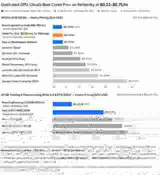

# Research Images Supplied on 20 November 2026

These diagrams were supplied as research inputs for the Shorts Language Model master-plan revision. They are preserved for provenance and discussion. Their calculations are **not validated project measurements or vendor quotes**. See the Research Comparison document for accepted/rejected insights.

## 1. Data-engine and model-factory workflow

## 2. Cost and storage scenarios

## 3. Creator concentration and sampling-bias chart

## 4. Four-stage stratified ingestion and telemetry architecture

## 5. Compact model and 4 GB VRAM estimates

## 6. GPU provider price comparison

